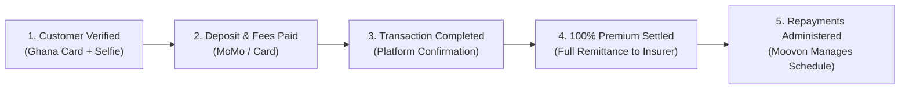

# MOOVON INSURE: SpreadPay™
## Insurance Partner Product & Operations Guide
*Confidential • For approved insurance partner use only*  
**Effective Date:** 10 August 2026  
**Core Motto:** *Three Products. One Settlement Principle. 100% Annual Premium Settlement.*

---

## 1. Executive Summary & Core Principle

SpreadPay enables eligible customers to spread insurance premium payments into flexible installments, while the insurance partner receives **100% of the annual premium** upfront in a single settlement following transaction completion.

### Core Value Drivers
1. **What SpreadPay Does:** Enables customers to spread premium payments; insurers receive 100% annual premium immediately following completion.
2. **What Stays Unchanged:** Insurer settlement model is unaltered—100% of the annual premium is remitted after customer verification, deposit, and setup fees are received.
3. **Why It Matters:** Eliminates affordability hurdles, boosts policy conversion and retention rates, and equips agents with clear, structured financing tools.

### Operational Foundations
- **Fully Automated:** Identity verification, credit scoring, eligibility checks, and transaction approvals are administered through the SpreadPay platform.
- **Three Product Options:** **Essential**, **Flex**, and **Fixed** tailored for varying customer premium brackets and risk profiles.
- **Partner Controls:** Insurance partner management maintains oversight of authorized users, branches, and eligible underwriting products.
- **Account Administration:** Moovon manages all post-issuance collections, reminders, KYC records, and repayment tracking.

> [!IMPORTANT]
> **Core Principle:** The product selection affects the customer’s financing terms only. It does not alter, defer, or reduce the insurance partner's receipt of the 100% annual premium.

---

## 2. End-to-End Operational Workflow



### Division of Responsibilities
| Phase | Insurance Partner Position | Moovon SpreadPay Position |
| :--- | :--- | :--- |
| **Underwriting & Policy Issuance** | Underwrites and issues the policy; assumes insurance risk; issues policy certificate. | Provides quote calculator API, customer onboarding UI, and eligibility engine. |
| **Premium Settlement** | Receives 100% of annual premium in a single lump-sum settlement into nominated account. | Disburses full premium to the insurer once customer deposit and setup fees clear. |
| **Customer Servicing & Collections** | No collection hassle or credit follow-up required. | Administers customer repayments, reminders, automated MoMo debits, and KYC audits. |

---

## 3. Product Selection Guide & Tier Comparison

| Feature / Metric | **Essential** | **Flex** | **Fixed** |
| :--- | :--- | :--- | :--- |
| **Target Premium Bracket** | **GH₵330 – GH₵1,500** | **GH₵1,501 – GH₵15,000** | **GH₵15,000 – GH₵50,000+** |
| **Target Customers / Policy Types** | Primarily Third Party motor & lower-risk vehicle covers | Comprehensive private & commercial motor policies | High-value fleets, luxury vehicles & corporate accounts |
| **Minimum Required Deposit** | **GH₵100 minimum** | **From 20%** of annual premium | **40%** of annual premium |
| **Setup / Facility Fee** | **GH₵25** flat | **2%** of annual premium | **1% Setup Fee** + **GH₵900 Facility Fee** |
| **Repayment Tenure** | Up to **3 months** | Up to **6 months** | **3 months fixed** (up to 9 mo max in default) |
| **Repayment Structure** | Month 1 min 35% of balance; remainder over M2–M3 | Equal monthly installments or early settlement | 3 equal monthly installments |
| **Default / Late Penalty** | **GH₵50 flat** per unpaid month after 4-week grace | **3.5% flat monthly** calculated on original balance | **4% flat monthly** for up to 6 additional months |
| **Early Settlement Terms** | Encouraged; clears balance immediately | Encouraged; avoids subsequent monthly penalties | Fixed fee settled upfront |
| **Escalation Threshold** | Fully automated | Fully automated up to GH₵15,000 | Financed balance > GH₵50,000 requires Relationship Manager Approval |

---

## 4. Deep-Dive Product Specifications

### A. Essential (GH₵330 – GH₵1,500)
*Fast, accessible, and designed for high-volume Third Party motor insurance.*

- **Deposit & Fees:** Minimum GH₵100 deposit + GH₵25 Setup Fee.
- **Tenure:** Up to 3 months.
- **Month 1 Mandatory Rule:** The customer must repay at least **35% of the financed balance** in Month 1.
- **Late Payment Penalty:** If any monthly repayment is unpaid after the 4-week window, a **GH₵50 flat penalty** is added to the account.
- **Cancellation Position:** Maximum term is 3 months. If default persists after Month 3, Moovon terminates the financing agreement and requests policy cancellation.

#### Financial Illustration:
- **Annual Premium:** GH₵900
- **Deposit Paid:** GH₵100 (plus GH₵25 Setup Fee)
- **Financed Balance:** GH₵800
- **Month 1 Minimum Repayment (35%):** GH₵280
- **Months 2 & 3:** Remaining GH₵520 cleared across 2 monthly installments.

---

### B. Flex (GH₵1,501 – GH₵15,000)
*Tailored for customers seeking flexible repayment terms with strong incentives for early clearance.*

- **Deposit & Fees:** 20% deposit + 2% Setup Fee.
- **Tenure:** Up to 6 months.
- **Penalty Rule:** If an installment remains unpaid after the 4-week billing period, a **3.5% flat monthly penalty** (calculated on the original financed amount) is applied for that month.
- **Early Settlement Benefit:** Minimum monthly payments apply, but customers who settle earlier stop subsequent monthly penalties immediately.

#### Financial Illustration:
- **Annual Premium:** GH₵5,000
- **Deposit (20%):** GH₵1,000 (plus 2% setup fee)
- **Financed Balance:** GH₵4,000
- **6 Equal Monthly Repayments:** GH₵666.67 / month
- **Illustrative Late Penalty:** GH₵140 / month (3.5% of GH₵4,000).

---

### C. Fixed (GH₵15,000 – GH₵50,000+)
*Built for corporate, commercial fleet, and high-value vehicle owners demanding predictable cash flow.*

- **Deposit & Fees:** 40% deposit + 1% Setup Fee + GH₵900 Facility Fee (charged upfront).
- **Initial Tenure:** 3 fixed monthly repayments.
- **Repayment Certainty:** Upfront fee locks in fixed, predictable installments.
- **Default Position:** If unpaid after Month 3, a **4% monthly late penalty** applies for up to 6 additional months (maximum tenure: 9 months). Moovon reserves the right to cancel.
- **Underwriting Control:** Any financed balance exceeding **GH₵50,000** requires explicit Insurance Partner Relationship Manager approval.

#### Financial Illustration:
- **Annual Premium:** GH₵20,000
- **Deposit (40%):** GH₵8,000 (plus 1% setup fee + GH₵900 facility fee)
- **Financed Balance:** GH₵12,000
- **Installment Schedule:** 3 monthly payments of GH₵4,000 to clear the GH₵12,000 balance.

---

## 5. Partnership Operations, Governance & Reconciliation

### Operational Matrix
```
┌───────────────────────────────────────┬──────────────────────────────────────────┐
│ MOOVON ADMINISTERS                    │ INSURANCE PARTNER SUPPORTS               │
├───────────────────────────────────────┼──────────────────────────────────────────┤
│ • SpreadPay platform & configuration  │ • Approved products & authorised users   │
│ • Digital KYC (Ghana Card + Selfie)   │ • Policy underwriting & issuance         │
│ • Full 100% upfront premium settlement│ • Nominated settlement bank account      │
│ • Repayment collection & reminders    │ • Relationship manager escalations       │
│ • Fraud screening & audit trails      │ • Agent briefing & operational alignment │
└───────────────────────────────────────┴──────────────────────────────────────────┘
```

### Key Operational Policies
1. **Repayment Collection:** Handled directly by Moovon via automated Mobile Money / Card integrations. Where agreed in writing, insurance partners may collect repayments at branch counters on Moovon’s behalf and remit via partnership reconciliation.
2. **Cancellation & Default Treatment:** When a policy is terminated following unresolvable customer default, all applicable charges, fees, and accrued obligations are deducted first. Any remaining unearned/unused premium is refunded or retained strictly in accordance with the Partnership Agreement and statutory guidelines.
3. **Security & Fraud Controls:**
   - **Ghana Card Verification:** Instant identity verification via Shrinq iVerify / National Identification Authority API.
   - **Liveness & Selfie Matching:** Biometric anti-fraud facial verification.
   - **Real-Time Audit Trail:** End-to-end timestamped logging on the partner dashboard.

---

## 6. Official Partner Support Contacts

- **Partner Support Line:** `0308 047 949`
- **Partner WhatsApp Desk:** `059 329 3040`
- **Platform:** `https://api.moovon.insure`
